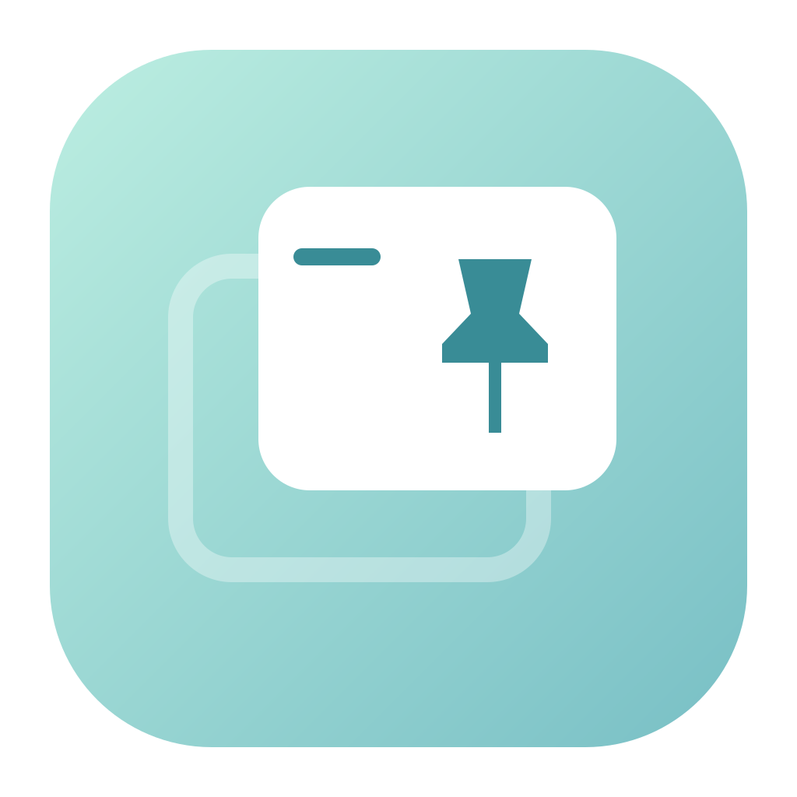

<p align="center"></p>

# CClose-MscOS

**by [flyhu2](https://github.com/flyhu2)** · v1.0.0 · macOS 14+ · Apple Silicon · MIT

用鼠标手势管理窗口，让参考内容保持可见。实时镜像悬浮，无需关闭 SIP 或安装 yabai。

[公开发布页](https://cclose-macos.velvetswan16.chatgpt.site) · [下载安装包](https://github.com/flyhu2/CClose-MacOS/releases/latest) · [反馈问题](https://github.com/flyhu2/CClose-MacOS/issues)

## 开始使用

1. 下载 ZIP、解压，将 `cclose-mac.app` 移入“应用程序”，打开。
2. 在系统设置 → 隐私与安全性中授予**辅助功能、输入监控、屏幕录制**权限。授权后退出并重新打开应用。
3. 在目标窗口**标题栏空白处**按住左键约 0.9 秒，松开后置顶；再次长按取消。
4. 左键或右键点击顶部菜单栏图标打开设置。设置立即生效，点击面板外收起。

安装包采用 ad-hoc 签名，**尚未经过 Apple 公证**。若系统阻止启动，请确认下载来源，在系统设置 → 隐私与安全性中选择“仍要打开”。无需关闭 SIP。更新前先退出旧版，避免同时运行多个副本。

## 手势

| 位置 | 操作 | 效果 |
| --- | --- | --- |
| 标题栏空白处 | 左键长按 | 置顶 / 取消置顶 |
| 标题栏空白处 | 右键 / 中键 | 最小化 / 关闭窗口 |
| 镜像标题栏空白处 | 拖动 / 双击 | 移动 / 放大后再次双击还原 |
| 镜像四边、四角 | 拖动 | 调整原窗口宽高，由原应用重新排版 |
| 前台窗口 | 双击 Esc（可关闭） | 关闭窗口 |

避开标签页、按钮和输入框。触控板需实际按下并保持；长按时间可调。关闭窗口不等同于退出整个应用。

## 两种悬浮方式

| | 普通重合模式（默认） | 独立桌面（可选） |
| --- | --- | --- |
| 原窗口 | 与镜像重合 | 目标应用的**全部窗口**移至工具创建的桌面 |
| 内容区 | 点击、滚动、拖选与右键回传；键盘输入激活原应用 | **仅预览**，点击、滚轮、拖选均不回传、不穿透 |
| 标题栏与缩放 | 支持 | 支持 |
| 不透明度 | 固定 100% | 20%–100%，默认 100% |

同时只保留一个悬浮窗口。独立桌面需在置顶前开启；关闭开关会立即取消悬浮并恢复原应用。取消或退出时先迁回窗口，再清理工具创建的空桌面；若其中有其他窗口则保留桌面。窗口已分散在多个桌面、全屏或“所有桌面”状态时会拒绝迁移。创建和清理会出现 Mission Control 动画。

缩放遵守原应用的最小尺寸。普通模式操作期间显示原窗口；独立模式保留完整画面，显示目标尺寸轮廓，新帧匹配后更新镜像，避免拉伸与露底。独立模式绘制超时会尝试重启捕获，仍未更新则撤回本次缩放、保留置顶。普通模式超时会返回原窗口。

圆角镜像、边框颜色与粗细可调；留白底色透明，不改变原应用自身的背景。独立模式需要操作内容时，自行切换到源应用；标题栏最小化、关闭和取消等操作仍可能恢复或激活原窗口。

## 权限与边界

- 辅助功能用于识别、调整窗口和事件回传；输入监控用于全局手势；屏幕录制用于镜像。画面仅在本机内存处理，不保存、不上传，不采集音频。
- 自绘标题栏、输入法和右键菜单兼容性取决于应用。普通模式可用 ⌘ 单击临时返回原窗口，切换到其他应用后恢复悬浮。
- 原应用可能暂停后台绘制；受保护视频可能黑屏。不保证覆盖其他全屏空间、锁屏或所有系统窗口。
- 独立桌面及部分事件路由依赖非公开接口，系统升级后可能失效；不修改 SIP，不注入 Dock。异常退出后下次启动尝试恢复桌面，失败时设置面板提供恢复入口。
- 当前发布 Apple Silicon 包。第三方应用连续拖动、跨显示器与睡眠唤醒仍需实际回归，详见[验证说明](docs/VALIDATION.md)。

## 开发

需要 Xcode / Command Line Tools 和 Swift 5.9+。

```sh
swift test
bash scripts/make_app.sh release
open dist/cclose-mac.app
```

打包前退出旧实例。`--diagnose` 只读检查权限，`--probe` 检查手势命中。核心实现位于 `Sources/CCloseMac`；DEBUG 验证入口不会包含在发布包中。推送 `v*` 标签后，GitHub Actions 测试、构建并上传 ZIP 与 SHA256。

## 鸣谢

- [chaohershi/cclose](https://github.com/chaohershi/cclose)（Chaohe Shi，MIT）：Windows 版本提供长按置顶、右键最小化、中键关闭的交互灵感。本项目为 flyhu2 的独立 macOS 实现。
- [WindowPin](https://github.com/PerpetualBeta/WindowPin)：定向鼠标事件技术参考。
- [MoveItHere](https://github.com/davidgeller/moveithere)：整应用桌面迁移技术参考。
- [Hammerspoon hs.spaces](https://github.com/Hammerspoon/hammerspoon/tree/master/extensions/spaces)：Mission Control 辅助功能接口参考。

Copyright © 2026 **flyhu2** · [MIT License](LICENSE)
